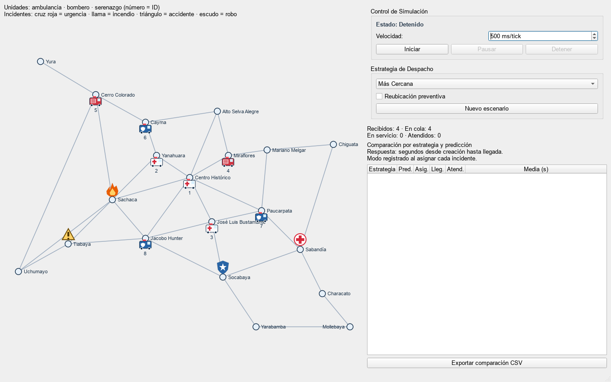
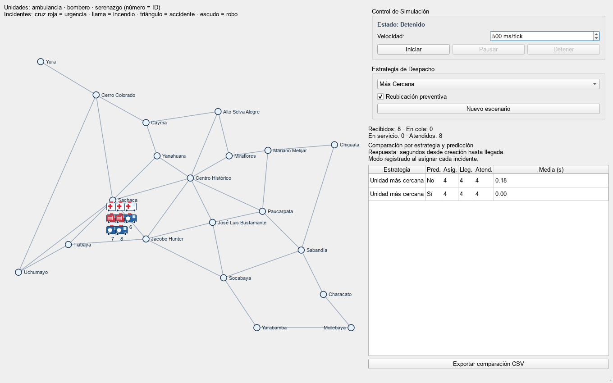

# SIDEA — Sistema Inteligente de Despacho de Emergencias de Arequipa

Simulador de despacho de emergencias para la ciudad de Arequipa. Gestiona ambulancias, bomberos y serenazgo en tiempo real sobre un grafo de 20 zonas, con tres estrategias de asignación intercambiables, predicción de zonas de riesgo y visualización animada.

Desarrollado en C++17 + Qt6 como proyecto de curso — Tecnología de Objetos, UNSA 2026-B.

**Repositorio:** [github.com/KarlaBedregal/SIDEA](https://github.com/KarlaBedregal/SIDEA)

---

## Qué hace el sistema

SIDEA simula la central de despacho de emergencias de Arequipa. Cuando llega un incidente (urgencia médica, incendio, accidente o robo), la central selecciona automáticamente la unidad más adecuada según la estrategia activa, la envía por la ruta óptima calculada con Dijkstra, y la unidad regresa a su base al terminar. Todo ocurre en hilos concurrentes; la interfaz se actualiza en tiempo real sin bloquear la lógica de despacho.

---

## Cómo usar

1. Compila y ejecuta el proyecto (ver sección **Compilar**). En la ventana principal verás el mapa de Arequipa con los 20 nodos y las ocho unidades en sus bases.
2. Elige la estrategia de despacho: **Más Cercana**, **Prioridad** o **Balance de Carga**.
3. Ajusta la velocidad del tick (100–5000 ms) y pulsa **Iniciar**. Se genera un incidente nuevo cada dos ticks. Las unidades salen animadas hacia el nodo del incidente.
4. **Pausar** detiene la generación y el movimiento conservando el estado. **Reanudar** continúa. **Detener** limpia los hilos pero conserva el escenario. **Nuevo escenario** reinicia todo desde cero.
5. Activa **Reubicación preventiva** para que las unidades libres se muevan hacia la zona de mayor riesgo histórico. El despacho de un incidente tiene prioridad sobre la reubicación.
6. El panel de estadísticas muestra incidentes atendidos por unidad y la comparación entre estrategias. Puedes exportar los resultados en CSV.

---

### Capturas reales

Mapa animado con íconos de los cuatro tipos de incidente y las ocho unidades desplegadas:



Panel de estadísticas con comparación por estrategia y reubicación preventiva activada:



Para regenerar las capturas:

```bash
QT_QPA_PLATFORM=offscreen ./build/SIDEA_capturas docs/capturas
```

---

### Comparación de estrategias

| Estrategia | Criterio de selección |
|---|---|
| Más cercana | Unidad libre con menor distancia Dijkstra al incidente |
| Prioridad | Unidad del tipo preferido para ese incidente (Ambulancia→médico, Bombero→incendio/accidente, Serenazgo→robo) |
| Balance de carga | Unidad libre con menos incidentes atendidos acumulados |

Resultados del escenario reproducible (24 incidentes, 8 unidades, demanda concentrada en Cerro Colorado):

| Estrategia | Predicción | Atendidos | Respuesta media (ticks) |
|---|---|---:|---:|
| Más cercana | No | 24/24 | 2.250 |
| Más cercana | Sí | 24/24 | 2.000 |
| Prioridad | No | 24/24 | 3.250 |
| Prioridad | Sí | 24/24 | 2.042 |
| Balance de carga | No | 24/24 | 3.083 |
| Balance de carga | Sí | 24/24 | 2.042 |

```bash
./build/SIDEA_comparar > docs/comparacion_prediccion.csv
```

---

## Patrones de diseño aplicados

| Patrón | Dónde | Por qué |
|---|---|---|
| **Strategy** | `EstrategiaDespacho` + 3 subclases | Cambiar el algoritmo de despacho en tiempo de ejecución sin modificar `CentralDespacho` |
| **Observer** | `IObserver` / `IObservable` → `MainWindow` | La GUI se actualiza automáticamente ante eventos de despacho sin acoplamiento directo |
| **Factory Method** | `UnidadFactory`, `IncidenteFactory` | Crear unidades e incidentes polimórficos sin exponer los constructores concretos |
| **State** | `EstadoLibre`, `EstadoEnRuta`, `EstadoAtendiendo`, `EstadoRegresando` | Cada estado encapsula el comportamiento de la unidad en ese ciclo |
| **Singleton** | `CentralDespacho::instancia()` | Un único punto de acceso al estado global del sistema desde GUI y threads |

---

## Diagramas UML

- [Clases](docs/UML/clases.puml) · [SVG](docs/UML/SIDEA_Clases.svg)
- [Estados de Unidad](docs/UML/estado_unidad.puml) · [SVG](docs/UML/Estado_Unidad.svg)
- [Secuencia de despacho](docs/UML/secuencia_despacho.puml) · [SVG](docs/UML/Secuencia_Despacho.svg)

Para regenerar los SVG con PlantUML:

```bash
java -jar plantuml.jar -charset UTF-8 -tsvg docs/UML/*.puml
```

---

## Compilar

Requiere CMake ≥ 3.20, compilador C++17 y Qt6 (Core, Widgets, Charts). La primera compilación descarga GoogleTest automáticamente vía FetchContent.

**Linux / macOS:**
```bash
sudo apt-get install cmake build-essential qt6-base-dev libqt6charts6-dev libgl1-mesa-dev
cmake -S . -B build -DCMAKE_BUILD_TYPE=Debug
cmake --build build --parallel
./build/SIDEA
```

**Windows (Qt MinGW):**
```powershell
$env:Path = "C:\Qt\Tools\CMake_64\bin;C:\Qt\Tools\mingw1310_64\bin;C:\Qt\6.12.0\mingw_64\bin;" + $env:Path
cmake -S . -B build -G "MinGW Makefiles" -DCMAKE_PREFIX_PATH=C:/Qt/6.12.0/mingw_64
cmake --build build --parallel 4
.\build\SIDEA.exe
```

**Qt Creator:** `File → Open File or Project → CMakeLists.txt`. Qt Creator detecta el proyecto CMake automáticamente y ofrece configurarlo con el kit de Qt6 instalado.

### Correr tests

```bash
ctest --test-dir build --output-on-failure
```

67 tests: lógica de core, estrategias, threading, predicción y GUI en modo offscreen.

---

## Estructura del proyecto

```
SIDEA/
├── src/
│   ├── core/          # Unidad, Incidente, CentralDespacho, Factories
│   │   └── states/    # Patrón State: Libre, EnRuta, Atendiendo, Regresando
│   ├── graph/         # Grafo<T>, Dijkstra<T>, ColaPrioridad<T>, MapaArequipa
│   ├── strategies/    # Patrón Strategy: 3 estrategias de despacho
│   ├── patterns/      # IObserver / IObservable
│   ├── threading/     # GeneradorIncidentes, SimuladorThread
│   ├── gui/           # MainWindow, MapaWidget, PanelControl, EstadisticasWidget, LogPanel
│   ├── stats/         # Estadisticas
│   └── prediction/    # HistorialIncidentes, ModeloPrediccion
├── tests/             # Tests unitarios (GoogleTest)
├── docs/
│   ├── UML/           # Diagramas PlantUML y SVG
│   └── capturas/      # Capturas reales del ejecutable
└── assets/            # Mapa OSM de Arequipa e íconos de unidades/incidentes
```
